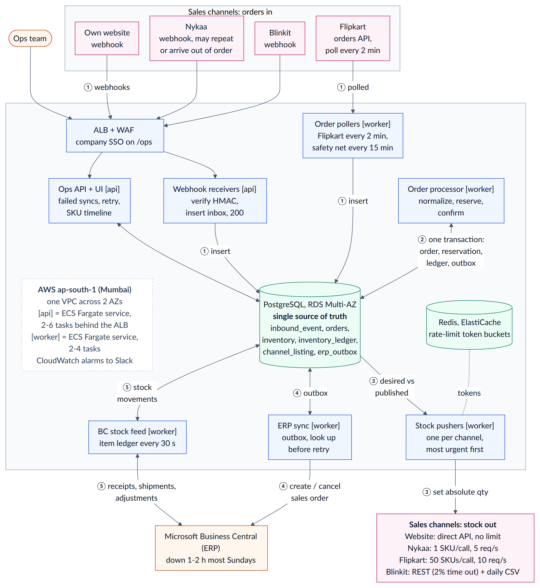

# Order & Inventory Sync Service: Design

**Approach.** One conditional `UPDATE` in Postgres reserves stock atomically with the order, ledger and outbox rows; inbox/outbox tables make outages delay work, never lose it; channels see stock minus a lag-sized buffer.

## 1. Architecture

**What runs where** (AWS ap-south-1, 2 AZs, one NestJS codebase; [diagram source](architecture.mmd)):
- **`api`** — ECS Fargate, 2–6 tasks behind ALB + WAF: webhook receivers; ops API/UI behind company SSO.
- **`worker`** — ECS Fargate, 2–4 tasks: order processor, pollers, per-channel stock pushers, ERP sync, BC stock feed; singletons hold a Postgres advisory lock (failover in seconds).
- **RDS PostgreSQL** (Multi-AZ, db.t4g.medium): all state and queues. **ElastiCache Redis**: rate-limit token buckets only; losing it loses nothing.

**Peak load and cost:** 300 orders/min = 5/s and a reservation takes ~10 ms: >10× headroom before autoscaling (CPU, backlog). ≈ ₹33k/month (~$350; ₹39k with GST) vs. the ₹50k budget.

## 2. Data model

| Table | Key columns | Constraints, purpose |
|---|---|---|
| `inbound_event` | channel, event_key, payload, status | **UNIQUE (channel, event_key)** (event id or payload hash): the inbox |
| `orders` | channel, external_order_id, order_no, status | **UNIQUE (channel, external_order_id)**; lines in `order_line` (sku, qty, RESERVED/SHORT/…) |
| `inventory` | **PK (sku, location_id)**, on_hand, reserved | CHECK (reserved ≥ 0); ATS = on_hand − reserved (alert if < 0); the row lock serializes reservations |
| `inventory_ledger` | sku, reason, Δon_hand, Δreserved, balances, order_line_id, source_ref, time | append-only; **UNIQUE (order_line_id, reason)**, (source_ref, reason) |
| `channel_listing` | **PK (channel, sku)**, buffer, published_qty, published_at | what each channel was last told |
| `erp_outbox` | ext_doc_no, kind, order_id, status, attempts, next_attempt_at, lease_until | **UNIQUE (ext_doc_no, kind)**; ext_doc_no = order_no, or order_no-line for a filled backorder |

**Two numbers, not one:** `on_hand` (in the warehouse) moves only with BC's physical events, `reserved` (promised, unshipped) only with orders, so neither overwrites the other. **Audit trail:** each change is a ledger row with reason and reference: reserve (reserved +q), cancel (−q), BC shipment (on_hand and reserved −q), receipt or QC-passed return (on_hand +q), count/damage (±q).

**No duplicate orders:** the inbox drops replays; `UNIQUE (channel, external_order_id)` merges webhook and poll copies (a concurrent duplicate waits on the index, then takes `ON CONFLICT DO NOTHING`); the ledger key makes re-runs no-ops.

## 3. Order ingestion

- **Webhooks** (website, Nykaa, Blinkit): verify HMAC, insert into the inbox (`ON CONFLICT DO NOTHING`), return `200` once it commits — duplicates too, so senders stop retrying. No logic in the request.
- **Polling** (Flipkart): every 120 s fetch orders *updated since* cursor − 5 min, store all pages, then advance the cursor: no gaps, no duplicates. A 15-min safety-net poll of webhook channels catches lost webhooks.
- **Processing:** workers claim inbox rows (`FOR UPDATE SKIP LOCKED`, woken by `LISTEN/NOTIFY`), normalize them and apply each in one transaction under a per-order lock (arrival → reservation < 1 s). Bad events (unknown SKU) are parked FAILED and alerted.
- **Out of order:** orders are forward-only state machines; CANCELLED before CREATED stores a tombstone (nothing reserved) and the late CREATED is ignored.
- **Channel down:** others are unaffected; Flipkart's cursor holds, senders retry, the safety-net poll fills gaps; an "orders/min vs. last week" alert catches silent outages.

## 4. Inventory consistency: the last unit, sold twice in one second

**Arbitration (hard guarantee).** Each line is reserved by one statement, `UPDATE inventory SET reserved = reserved + q WHERE (sku, location_id) = (s, l) AND on_hand − reserved >= q`, so check and increment are atomic. Concurrent updates queue on the SKU's row lock, and under READ COMMITTED Postgres re-checks the waiting `WHERE` against the committed row. No SERIALIZABLE, no distributed lock; a hot row takes 100+ updates/s, our busiest SKU < 1/s.

**Walk-through:** slow seller MRS-KJL-011 (buffers 0, every channel shows 1); on_hand 3, reserved 2.

| Time | What happens |
|---|---|
| 11:04:52.1 / .4 | Nykaa sells it (its own count → 0), then the website does; both webhooks land in the inbox (`200`). |
| .510 | Workers A (Nykaa) and B (website) each claim one event; first to lock the row wins (not channel clocks). A locks it: 3 − 2 ≥ 1 → reserved 3; writes RESERVE + `erp_outbox`; commits in ~3 ms. |
| .513 | B, waiting on the lock, is re-checked on A's row: 3 − 3 ≥ 1 fails → 0 rows. B marks the line SHORT, logs SHORTAGE, creates no ERP task. |
| .52 | Pushers set 0 everywhere (website ~1 s, others within seconds). |
| Later | B is backordered: freed units (cancels are 6% of orders, returns, receipts) go to the oldest SHORT line; unfilled by its deadline (website 4 h, marketplace SLA), ops cancels it (counts in the 0.5%). |

**Prevention.** The lock picks a winner but can't stop a marketplace selling a unit it still shows. So channel c is shown **max(0, ATS − buffer(c))**, buffer ≈ the SKU's *total* peak sales/min × c's *blind window* (how late we hear of c's sales + how late c hears of ours; total, because other channels can resell what c sold unseen): website ~2 s, Nykaa/Blinkit ~20 s, Flipkart ~150 s. A hero lipstick selling 15/min at sale peak gets 38 / 5 / 5 / 0 (Flipkart / Nykaa / Blinkit / website): slow channels hit 0 first, so the last units sell only on the website (fastest loop, no commission, no seller rating at risk). **Budget:** 0.5% of 80k orders = 400; without buffers one hero stockout can oversell ~38 units through Flipkart's blind window; with them, only a burst above the planned rate can. v1: buffers per SKU class × channel, plus a sale-day profile. [Pseudo-code](PSEUDOCODE.md).

## 5. Stock push: four rate limits, 60 seconds

One pusher per channel wakes on `NOTIFY` (or every 2 s), computes desired qty for all 1,200 listings in one query, and sends rows where desired ≠ published, most urgent first, within its token bucket: **P0** to zero/low stock → **P1** back in stock → **P2** ≥ 20% change → **P3** the rest (promoted after 5 min). It sends the current absolute value, so bursts merge into one call and retries are safe. On 429: honor `Retry-After`, halve the rate for 30 s. Anti-entropy: Flipkart full refresh every 15 min, Nykaa nightly, Blinkit via CSV.

| Channel | Budget | Normal (~30 changes/min) | Sale peak (~600 line updates/min) |
|---|---|---|---|
| Website | direct API, no limit | ~1 s | ~1 s |
| Flipkart | 50 SKUs/call, 8 req/s | ≤ 5 s | whole catalogue = 24 calls ≈ 3 s |
| Nykaa | 1 SKU/call, 5 req/s | ≤ 10 s | P0/P1 < 20 s; P3 drift absorbed by buffers, refreshed ≤ 5 min |
| Blinkit | REST ~5 req/s + 05:00 CSV | ≤ 10 s | as Nykaa; SKUs changed after the CSV snapshot re-pushed |

## 6. Failure handling

- **Retries:** timeouts/5xx/429 back off exponentially with jitter (2 s → 15 min); 4xx go to ops. **Isolation:** per-integration pools, timeouts, circuit breakers and per-channel concurrency caps.
- **ERP Sunday downtime:** the outbox row is written at confirmation, so selling never waits on the ERP; the worker pauses in the maintenance window. 2 h queue ~700 orders; at 4 parallel calls (BC allows 5) × ~0.5 s it clears ~8/s, draining them in ~1.5 min and outpacing the 5/s sale peak.
- **Exactly once** = at-least-once + idempotent check: BC has no idempotency key and accepts duplicate External Document Numbers, so each document (one deep insert) carries `externalDocumentNumber = ext_doc_no`, and every retry first looks it up, ≥ 10 min after the last try (BC's request timeout is 8 min). A row lease means one sender; a cancel whose CREATE is already claimed queues a CANCEL.
- **Blinkit timeouts (2%):** writes are absolute, so retry at once with the latest value (3 in a row ≈ 1 in 125,000); correlated failures open its breaker, and the CSV repairs drift.
- **Messages that keep failing** become DEAD after their budget (inbound 5 tries, ERP 24 h): a status, so nothing queues behind them. The **ops screen** lists FAILED/DEAD rows with payload and error, plus *Retry*, *Fix mapping & retry* and *Resolve* (logged in `ops_action`); DEAD ERP rows page on-call.

## 7. Observability (day one)

1. **Oversell rate:** SHORT lines/hour by channel; alert at 0.2% or any SHORT > 30 min.
2. **Stock freshness:** oldest pending P0/P1 push per channel; alert > 60 s.
3. **ERP backlog:** oldest pending outbox row > 15 min (outside maintenance), or any DEAD.
4. **Ingestion health:** orders/min per channel vs. last week; Flipkart poll gap > 6 min.
5. **Errors and drift:** 429/5xx/timeout rates, breaker opens; nightly `reserved`/`on_hand` reconciliation.

## 8. Scope and delivery

**Not in v1:** velocity-based buffers (tune static ones first) · bundles (BOM-aware ATS) · Kafka/SQS, microservices, multi-region DR (nothing to solve at 5 orders/s) · price/catalogue sync, invoicing, returns QC (marketplaces and BC own these).

**v1.1:** website checkout holds, a 10-min reservation at checkout so the website never oversells, failing open if we're down ([pseudo-code](PSEUDOCODE.md#website-checkout-hold-v11)). A 5th channel is one adapter plus config ([how](ADDING_A_CHANNEL.md)).

**Delivery (6 weeks, 3 devs):** core + concurrency tests → adapters → pushers + ERP sync → ops screen + alarms → load and failure drills → shadow mode, then per-channel go-live.

## 9. Stretch A: Bengaluru warehouse

Inventory is already keyed by location: add BLR rows, a pincode → location map and `order_line.location_id`; reserve at the nearest location that can ship the whole order (same conditional UPDATE); channels see their serving locations' sum; BC lines carry a location (its item-ledger API lacks one: a small custom API page).

## 10. Trade-offs

| Decision | Chose | Rejected | Why |
|---|---|---|---|
| Reservation | Postgres conditional UPDATE | Redis Lua; FOR UPDATE; SERIALIZABLE | One ACID transaction, no dual write; async Redis replication can lose acknowledged reservations on failover ([Shopify moved reservations from Redis to MySQL](https://shopify.engineering/scaling-inventory-reservations) for this, 2026). |
| Queues | Postgres inbox/outbox + `SKIP LOCKED` | SQS, BullMQ, Kafka | Messages commit with the business change; one datastore; ops screen is SQL. Revisit > ~500 jobs/s. |
| Stock push | Reconcile desired vs. published | Message per change | Merges bursts to fit 5 req/s; self-heals; idempotent. |
| Oversell guard | Shared pool + lag-sized buffers | Fixed split per channel; no buffers | A split strands stock; no buffers leaves Flipkart's 2-min window open. |

## 11. Assumptions

- Webhooks are HMAC-signed and retried on non-2xx; channels have stable order ids and an "orders updated since" API; rate limits are per account, shared across endpoints.
- Marketplaces decrement their own displayed stock on sale; our updates set absolute quantities. Blinkit REST: 1 SKU/call, ~5 req/s; ad-hoc CSV allowed.
- One listing = one SKU; dispatch SLA ≥ 24 h; lines confirm independently (partial shipment, item-level cancel). Cancels release stock at once; returns/RTO restock only when BC records them sellable (opened cosmetics often aren't).
- BC API v2.0 via a dedicated user (5 concurrent, 6,000 req/5 min; ~0.5 s per order), one BC customer per channel; BC owns physical stock (item ledger read every 30 s). ~2 lines/order; peak hour ≈ 2.5× average; ap-south-1 prices, ₹95/USD.

**AI usage:** Claude Code (Claude Opus 5.5) researched AWS/BC facts and patterns, checked arithmetic, drafted this doc and diagram; I reviewed it all and can defend every decision.
